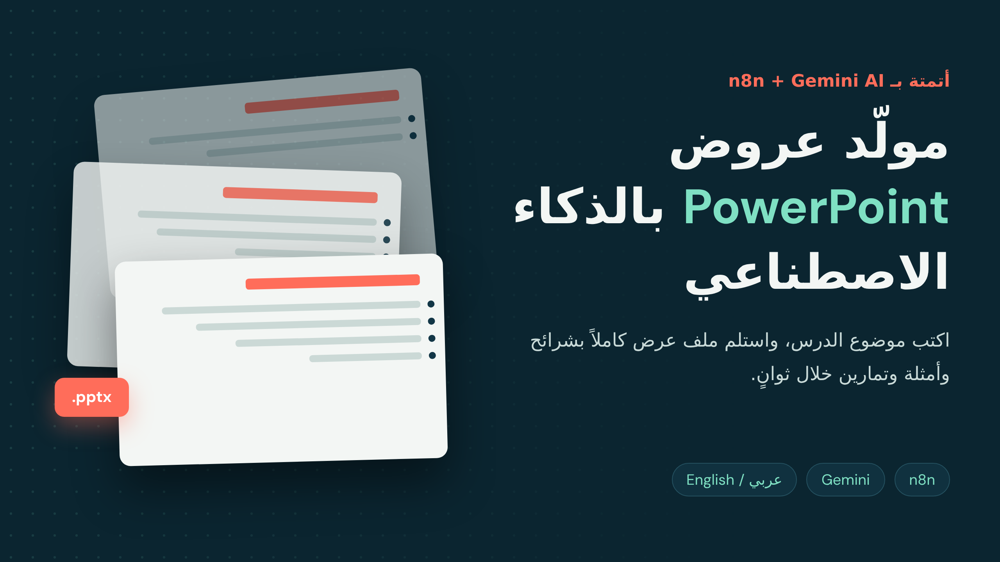
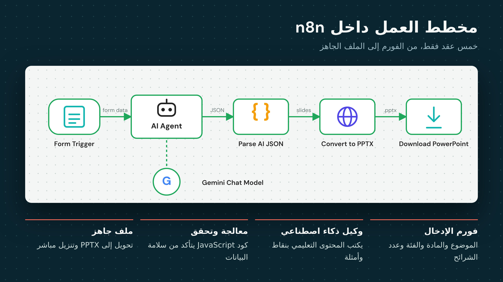
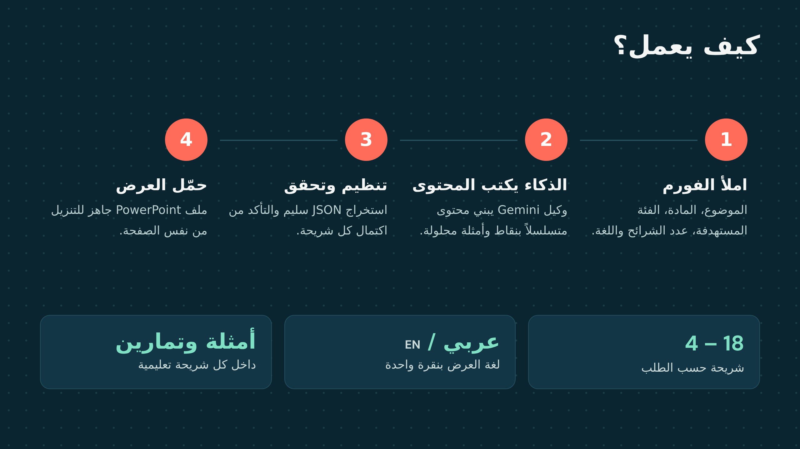
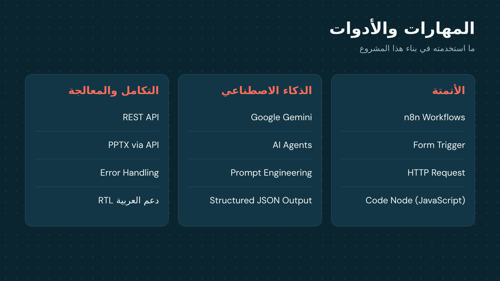

<div align="center">



# AI PowerPoint Creator

**n8n workflow that turns a topic into a ready-to-download PowerPoint, powered by Google Gemini.**

مولّد عروض PowerPoint بالذكاء الاصطناعي، يعمل بالعربية والإنجليزية.

</div>

## ما هو؟

اكتب موضوع الدرس في فورم بسيط، وسيكتب وكيل الذكاء الاصطناعي محتوى تعليمياً متسلسلاً (نقاط، أمثلة محلولة، تمارين)، ثم يتحوّل إلى ملف `.pptx` جاهز للتنزيل.

A form-driven n8n workflow: you enter a topic, an AI agent writes structured slide content, and the workflow returns a downloadable `.pptx` file.



## المزايا

- من 4 إلى 18 شريحة حسب الطلب
- عربي / English
- أمثلة وتمارين داخل كل شريحة
- التحقق من صحة JSON قبل التحويل مع رسائل خطأ واضحة
- فورم جاهز بدون أي واجهة إضافية



## هيكل الـ Workflow

| العقدة | الوظيفة |
|---|---|
| Form Trigger | استقبال الموضوع والمادة والفئة وعدد الشرائح واللغة |
| AI Agent + Gemini Chat Model | توليد محتوى العرض بصيغة JSON |
| Parse AI JSON | استخراج JSON وتنظيفه والتحقق منه (Code node) |
| Convert to PPTX | إرسال البيانات إلى خدمة تحويل (HTTP Request) |
| Download PowerPoint | إرجاع الملف للمستخدم للتنزيل |

## التشغيل

1. شغّل n8n (Cloud أو self-hosted).
2. من **Workflows → Import from File** اختر `workflow/ai-powerpoint-creator.json`.
3. في عقدة **Gemini Chat Model** أضف بيانات اعتماد Google Gemini (API key).
4. في عقدة **Convert to PPTX** ضع رابط خدمة التحويل بدل `https://YOUR-PPTX-SERVICE-URL/pptx`.
5. فعّل الـ workflow وافتح رابط الفورم.

### صيغة خدمة التحويل

تستقبل الخدمة طلب `POST` على `/pptx` بالجسم التالي، وتُرجع ملف `.pptx`:

```json
{
  "title": "عنوان العرض",
  "subtitle": "وصف قصير والفئة المستهدفة",
  "slides": [
    {
      "title": "عنوان الشريحة",
      "bullets": ["نقطة أولى", "نقطة ثانية", "نقطة ثالثة"],
      "example": "مثال تطبيقي مع الحل والنتيجة"
    }
  ]
}
```

> خدمة التحويل ليست جزءاً من هذا المستودع. يمكن بناؤها بـ `python-pptx` أو `pptxgenjs`.

## المهارات

n8n · AI Agents · Google Gemini · Prompt Engineering · Structured JSON Output · JavaScript · REST API



## الترخيص

MIT
